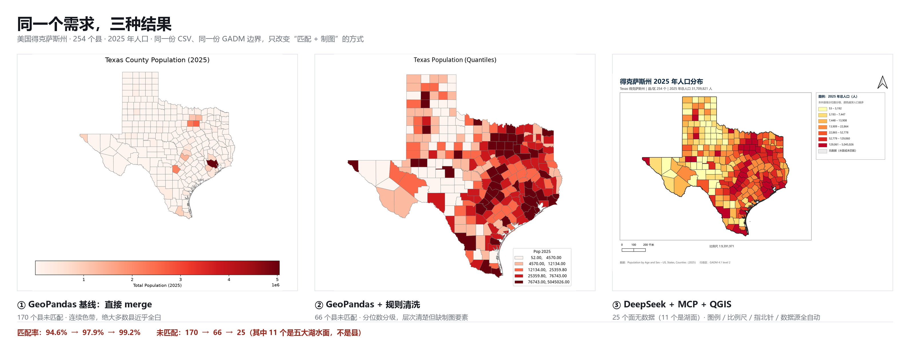
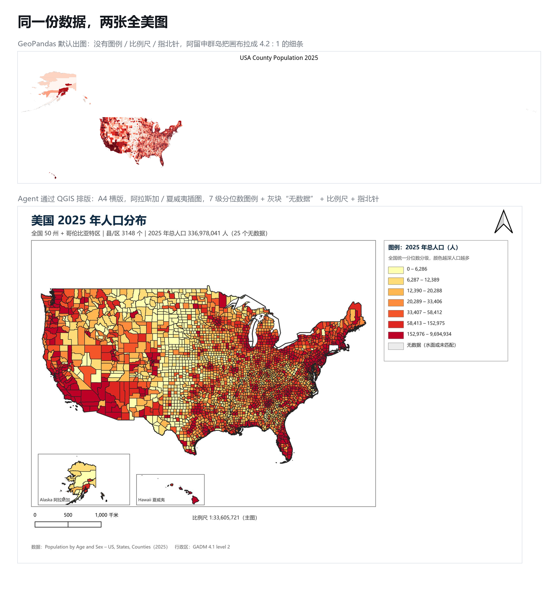

# US County Population Mapping: GeoPandas vs an LLM Agent Driving QGIS

**English summary of [README.md](README.md).** Same population table, same GADM boundary, same model (DeepSeek). One path is hand-written GeoPandas + Matplotlib; the other lets the model operate QGIS through the Model Context Protocol (MCP).

| | GeoPandas (naive) | GeoPandas (rule-cleaned) | DeepSeek + MCP + QGIS |
|---|---|---|---|
| Join key | county name `merge` | normalised names | normalised + aliases + conflict checks |
| Matched | 2,978 / 3,148 | 3,082 / 3,148 | **3,123 / 3,148** |
| Unmatched | 170 | 66 | **25** |
| Match rate | 94.6% | 97.9% | **99.2%** |
| Outputs | 48 PNGs (3 states missing) | 50 PNGs (CT missing) | 51 JPGs + national map + 52-page PDF |



## Why the agent wins (and why it is not magic)

GADM has no FIPS code, so the join is an **attribute join on state + county names**. Most errors come from `Parish`, `Borough`, `Census Area`, `Independent City`, `De Kalb` vs `DeKalb`, `Ste.` vs `Sainte`, and renamed units — not from geometry.

The agent wrote PyQGIS code inside QGIS. It did **not** use a spatial join, so the improvement is **not** due to "QGIS's spatial engine". It improved because the model:

1. added a space-insensitive second index (`De Kalb` / `Mc Kean`);
2. detected city/county collisions (`Fairfax Independent City` overwriting `Fairfax` county) and rewrote the assignment;
3. read back `getFieldStatistics` and sample values, noticed the mismatch, and iterated: 3,114 → 3,120 → 3,119 → **3,123**.

Of the 25 unmatched polygons, **11 are lake polygons** (`TYPE_2 = Water body`), not counties. Excluding water, effective coverage is **3,123 / 3,137 = 99.55%**.

It also produced the cartography: A4 landscape at 200 dpi, per-state quantile classes, grey "no data" swatch, scale bar, north arrow, data-source footnote — 51 state maps in one turn, then a national map and a 52-page PDF atlas, and finally asked what to do next.



## Verify it yourself

Only the Python standard library is needed:

```bash
python code/verify_join_quality.py \
  --gadm-dbf gadm41_USA_2.dbf \
  --population-csv data/population_2025_counties.csv
```

```
baseline  (naive)    : 2978 matched / 170 unmatched (94.60%)
cleaned   (rules)    : 3082 matched / 66 unmatched (97.90%)
agent     (POP_2025) : 3123 matched / 25 unmatched (99.21%)
```

The third line reads `POP_2025` from the `.dbf` that the QGIS session wrote — the agent's result is independently checkable.

## What this is not

A controlled benchmark. One dataset, one run, no timing or token-cost measurement, and the boundary layer (GADM 4.1) is older than the 2025 population table (Connecticut planning regions, Alaska census areas, Virginia cities). Details and error taxonomy: [docs/comparison.md](docs/comparison.md).

## Repository layout

See [README.md §8](README.md#8-目录结构). Key files: `code/verify_join_quality.py`, `code/geopandas/`, `code/qgis_mcp/`, `docs/mcp-setup.md`, `album/USA_2025_Population_Atlas.pdf`.

## License

Code: MIT. Boundary: GADM license (not redistributed). Maps: CC BY 4.0.
