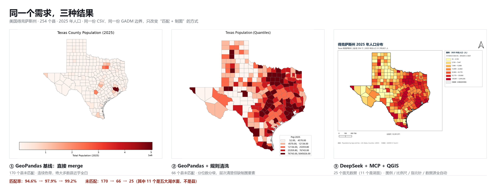
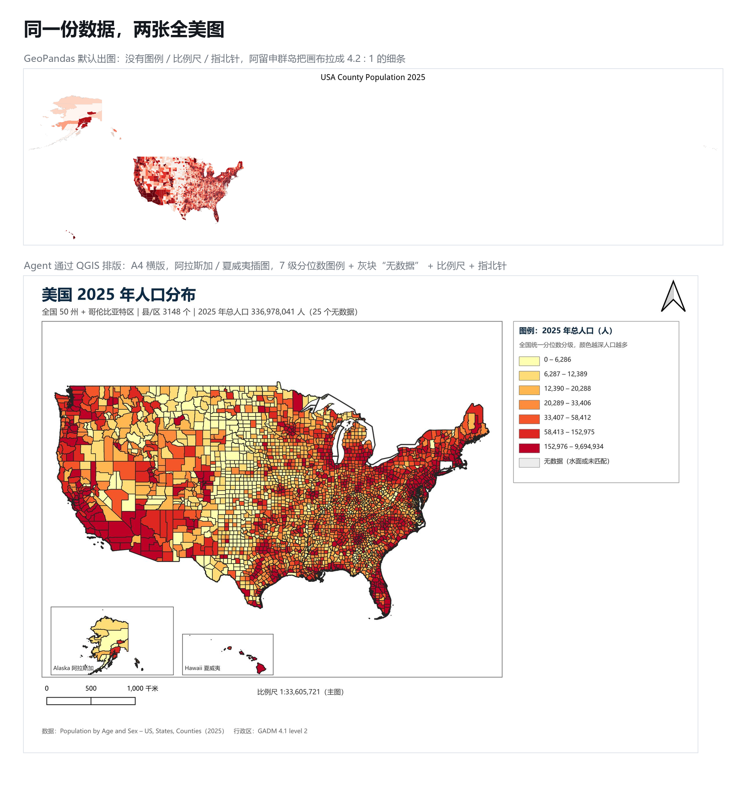

# 美国 3,148 个县的人口制图：GeoPandas 手工流水线 vs QGIS MCP Agent

> 同一份 CSV、同一份 GADM 边界、同一个模型（DeepSeek）。
> 一条路是我手写 GeoPandas + Matplotlib；另一条是让模型通过 **MCP** 直接操作 **QGIS**。
> 未匹配的县从 **170 → 66 → 25**，最后 51 张州图、1 张全美图、1 本 52 页 PDF 画册，全部由自然语言驱动完成。

[](https://www.python.org/)
[](https://geopandas.org/)
[](https://qgis.org/)
[](https://modelcontextprotocol.io/)
[](data/README.md)
[](LICENSE)

**English TL;DR** — Same input data, same boundary layer. A rule-based GeoPandas pipeline leaves **66 / 3,148** polygons unmatched; an LLM agent driving QGIS over MCP leaves **25** (11 of them are lake polygons), and turns a natural-language request into 51 state maps plus a 52-page PDF atlas. This is a reproducible POC, **not** a controlled benchmark: all numbers below are verified against the data, and the limitations are documented.

---

## 30 秒看懂

|  | GeoPandas 基线 | GeoPandas + 规则清洗 | DeepSeek + MCP + QGIS |
|---|---|---|---|
| 匹配方式 | 县名直接 `merge` | 名称标准化（6 类后缀 + 缩写） | 标准化 + 空格归一 + 别名 + 冲突检测 |
| 县级单元 | 3,148 | 3,148 | 3,148 |
| 匹配成功 | 2,978 | 3,082 | **3,123** |
| 未匹配 | 170 | 66 | **25** |
| 匹配率 | 94.6% | 97.9% | **99.2%** |
| 产出 | 48 张 PNG（缺 3 个州） | 50 张 PNG（缺康州） | 51 张州图 + 全美图 + 52 页 PDF |
| 人工操作 | 写代码、调色带 | 补清洗规则 | 只说需求 |
| 制图要素 | 标题 + 色带 | 标题 + 分位数图例 | 标题 / 副标题 / 图例 / 比例尺 / 指北针 / 数据源 |



> 得克萨斯州（254 个县）在三条流水线下的输出。第一张和第三张的差别不只是“好不好看”：第一张里大片浅色既是低人口，也是没匹配上的县，**两种含义用了同一种颜色**——这是制图上最危险的情况。第三张把“无数据”单独设为灰色并在图例中注明。

---

## 1. 这个项目在比什么

任务本身很朴素：

1. 把一份 **2000–2025 年美国分县人口 CSV** 中 `Year = 2025` 的 `Total Population`；
2. 挂接到 **GADM 4.1 level-2** 的县界多边形上（3,148 个要素）；
3. 按州输出人口热力图，并做一本全美画册。

难点不在“画图”，而在**两边没有共同主键**：GADM 只有 `NAME_1`（州名）和 `NAME_2`（县名），没有 FIPS；CSV 的 `Countyfips` 是州内编号，不能直接跨州连接。于是大部分工作量都落在**地名标准化**——`Parish`、`Borough`、`Census Area`、`Independent City`、`De Kalb`、`Ste.`、`St.`，以及改名、撤并、跨版本差异。

我做了三轮：

- **第一轮**：最直觉的 `merge`，结果 170 个县没匹配上，3 个州整州空白；
- **第二轮**：手写清洗规则，降到 66 个，但仍有整州缺失、图面留白、样式全靠调参；
- **第三轮**：QGIS 装 MCP 插件，Cherry Studio 接上 MCP 服务器，用 DeepSeek API 以自然语言驱动，降到 25 个，并自动完成全部排版与画册。

> 这不是“AI 完胜人类”的故事。第三轮里模型写的仍然是 Python（PyQGIS），只是它把清洗规则写得更全、会自己查统计量、发现错误后重跑。**真正被验证的是：Agent 能替人完成“写代码—验证—改代码—再验证”这个循环。**

---

## 2. 数据

| 项目 | 内容 |
|---|---|
| 人口 | *Population by Age and Sex – US, States, Counties*，83,104 行（2000–2025，每年 3,197 行） |
| 使用切片 | `Year = 2025` 且 `Countyfips > 0`，共 **3,145** 条县级记录，合计 **341,798,195** 人 |
| 边界 | GADM 4.1 level 2（`gadm41_USA_2.shp`），**3,148** 个要素，51 个 `NAME_1`，EPSG:4326 |
| 连接键 | `NAME_1 + NAME_2` ↔ `州全称 + 县名`（无 FIPS，必须做名称标准化） |

仓库不重新分发 GADM 原始边界（单文件 33–42 MB，且有其自身许可），只保留 **2025 年县级人口切片**（[data/population_2025_counties.csv](data/population_2025_counties.csv)）与下载说明，见 [data/README.md](data/README.md)。

两个容易忽略的事实：

- GADM 的 3,148 个要素里有 **11 个是五大湖水面多边形**（`TYPE_2 = Water body`），它们不是县，CSV 里当然没有人口；
- CSV 的 3,145 行里有 1 行重复（Oglala Lakota, SD），且 2025 年康涅狄格州用的是 **9 个 Planning Region**，而 GADM 仍是旧 **8 县**——这两个版本对不上，任何“按名字匹配”的方法都无法自动解决。

---

## 3. 三条流水线

### 3.1 基线：直接 merge（170 个未匹配）

```python
gdf["NAME_1"] = gdf["NAME_1"].str.upper()
gdf["NAME_2"] = gdf["NAME_2"].str.upper()
pop["County"] = pop["County"].str.upper().str.replace(" COUNTY", "", regex=False)

merged = gdf.merge(pop, left_on=["NAME_1", "NAME_2"], right_on=["State", "County"], how="left")
# -> 2,978 / 3,148，170 个未匹配
```

只用“去掉 County + 转大写”这一条规则，结果：

- **路易斯安那** 64 个 `Parish`、**弗吉尼亚** 38 个 `Independent City`、**阿拉斯加** 26 个 `Borough / Census Area` 全部落空；
- **阿拉斯加、康涅狄格、路易斯安那** 三个州**整州**没有人口，直接被 `if Population.isna().all(): continue` 跳过——所以第一版只有 48 张图；
- 剩下的是 `De Kalb / DeKalb`、`Mc Kean / McKean`、`Ste. / Sainte` 这类空格与缩写差异。

### 3.2 第二轮：规则清洗（66 个未匹配）

在基线上补了 6 类后缀与缩写，并把渲染从“连续色带”改成“分位数分级”：

```python
def clean_name(name):
    n = str(name).upper().strip()
    for suffix in [" COUNTY", " PARISH", " BOROUGH", " CENSUS AREA", " CITY", " MUNICIPALITY"]:
        n = n.replace(suffix, "")
    n = n.replace("ST. ", "SAINT ").replace("FT. ", "FORT ").replace("MT. ", "MOUNT ")
    return n.strip()

merged = gdf.merge(pop_clean, left_on=["NAME_1", "NAME_2"], right_on=["State", "County"], how="left")
# -> 3,082 / 3,148，66 个未匹配（Notebook 里按合并行数打印为 3,084 / 3,150）
```

`scheme="Quantiles", k=5` 解决了“休斯敦一个县把色带拉满、其余全白”的问题，但图面仍然只有标题和一个默认图例：没有比例尺、指北针、数据来源，也没有告诉读者**空白格到底是 0 人还是没数据**。

### 3.3 第三轮：DeepSeek + MCP + QGIS（25 个未匹配）

```
自然语言需求
   │
   ▼
Cherry Studio（DeepSeek API，deepseek-flash）
   │  MCP over stdio
   ▼
qgis-mcp server ── socket :9876 ──▶ QGIS 4.2 插件 ──▶ PyQGIS / QGIS 引擎
   │                                                    │
   └────────────── 工具返回值（JSON / PNG）◀────────────┘
```

QGIS 里装 `qgis-mcp` 插件并监听 `localhost:9876`，Cherry Studio 以 stdio 方式拉起 MCP 服务器。模型能拿到图层、字段、统计量，也能直接执行 PyQGIS——所以它做属性挂接的方式不是点“连接”对话框，而是**自己写一段 Python，把值写进新字段**。

**它是怎么把 66 降到 25 的**（会话实录见 [code/qgis_mcp/session_evidence.md](code/qgis_mcp/session_evidence.md)，方法分析见 [docs/comparison.md](docs/comparison.md)）：

| 轮次 | 做了什么 | 匹配数 |
|---|---|---|
| 第 1 版 | `lower()` + 去标点 + 去类型后缀 | 3,114 |
| 第 2 版 | 发现 `De Kalb / Mc Kean` 空格问题，加“去空格比较” | 3,120 |
| 第 3 版 | 发现 `Fairfax Independent City` 被写进了 `Fairfax` **县**、`Richmond` 市被写进 `Richmond` 县，改成“市/县候选优先 + 已占用检测” | 3,119 |
| 第 4 版 | 修正 `Charles City`、`James City` 被误判为“市”的 bug；补 Oglala Lakota → Shannon 别名 | **3,123** |

最后它自己打印出了校验：洛杉矶县 9,694,934、哈里斯县 5,045,026、Kings(NY) 2,653,963、Alexandria 160,662 均与 CSV 一致，合计 336,978,041。

这一轮 51 张州图是**一次对话、一次确认**完成的：模型连续发起 62 次工具调用，建布局、设分级、加比例尺/指北针/图例、导出 200 dpi 的 A4 横版 JPEG，最后还清理了临时布局。它随后主动问：

> “需要我再补一份**多页 PDF 合集**或**全国总图**放进同一文件夹吗？另外工程目前尚未保存，需要我保存吗？”

全美图和 52 页 PDF 画册就是顺着这句话做出来的。



---

## 4. 误差解剖：66 与 25 分别是什么

| 类别 | GeoPandas | Agent | 说明 |
|---|---:|---:|---|
| 五大湖水面多边形 | 11 | 11 | 不是县，CSV 中不存在；正确做法是标灰 + 图例注明 |
| 康涅狄格旧县 vs 2025 规划区 | 8 | 8 | 数据版本不一致，非匹配算法问题，只能人工做人口加权映射 |
| 弗吉尼亚独立市 | 35 | **2** | Agent 识别了 `Independent City` 后缀；剩 2 个是已撤销的 Bedford City / Clifton Forge City |
| 阿拉斯加旧普查区 | 5 | **4** | 名称几经合并更名（如 Skagway-Yakutat-Angoon） |
| `De Kalb` / `DeKalb` | 4 | **0** | 去空格归一化 |
| `Ste. Genevieve` | 1 | **0** | 缩写归一化 |
| `Mc Kean` / `McKean` | 1 | **0** | 去空格归一化 |
| `Shannon` → `Oglala Lakota` | 1 | **0** | 别名映射 |
| **合计** | **66** | **25** | **多解决 41 个** |

**25 个里有 11 个是湖面**。把水面剔除后，真实的数据缺口只有 14 个（8 个康州旧县 + 4 个阿拉斯加旧区 + 2 个已撤销的弗吉尼亚市），有效覆盖率是 **3,123 / 3,137 = 99.55%**。

另一个必须说清楚的点：25 个“无数据面”之外，还有 **4 条市/县同名记录**（Baltimore City、St. Louis City、Franklin City、Richmond City）因为 GADM 没有对应的市多边形而无法落位。它们合计约 **109 万人**没有进入图面；加上康州 9 个规划区的 **369 万人**，正好解释了全美合计 336,978,041 与 CSV 341,798,195 之间约 **482 万**的差额。这不是“AI 算错了”，而是边界版本本身的缺口——但它必须被写出来，而不是藏起来。

---

## 5. 制图差距在哪

|  | GeoPandas | QGIS MCP Agent |
|---|---|---|
| 画幅 | `figsize=(12,10)`，`bbox_inches="tight"` | A4 横版 297×210 mm，200 dpi，2338×1653 px |
| 分级 | 单一连续色带（第一版）/ 全州统一 5 分位（第二版） | 每州内部 7 级分位数，县少的州自动降为 5/3/1 级 |
| 无数据 | 空白，无说明 | 灰色 + 图例“无数据（水面或未匹配）” |
| 图例 | 默认色条，区间是浮点数 | 千分位断点 + 分级说明 |
| 比例尺 | 无 | 自适应公里比例尺 + 数值比例尺（每州不同） |
| 指北针 / 数据源 | 无 | 有 |
| 标题 | 英文一句 | 中文主标题 + 英文州名 + 单元数 + 总人口 + 无数据数 |
| 全美图 | 阿留申群岛把画布拉成 4.2:1，大片空白 | 本土主图 + 阿拉斯加/夏威夷插图，A4 构图 |
| 命名 | `{State}_pop.png` | `01_阿拉巴马州_2025年人口分布.jpg` … 按字母序 |
| 画册 | 无 | 52 页 PDF（1 张全美 + 51 州） |

GeoPandas 不是画不出好图，而是**每一处“专业制图默认值”都要自己写**：比例尺要算经纬度跨度、指北针要贴图片、阿拉斯加要处理 180° 经线、图例要格式化断点。这些在 QGIS 里是布局器的既有能力，模型只需要“调用 + 组合”。

---

## 6. Agent 做对了什么，又错在哪

**做对的：**

- **闭环**：读数据 → 建字段 → 写值 → 查统计量 → 发现异常 → 改规则 → 重跑 → 出图 → 自检 → 追问下一步，全程没有让我点 QGIS；
- **会自查**：`getFieldStatistics` 校验总和与极值，抽样核对洛杉矶/哈里斯/Alexandria；发现县/市同名覆盖后主动重写；
- **主动暴露问题**：交图前单独列出 Baltimore City、St. Louis City、Franklin、Richmond 四条市/县同名记录，给出具体数值，并让我选“并入县 / 留空 / 面积加权”，没有静默处理；
- **懂制图惯例**：分位数分级、灰块表“无数据”、比例尺随州自适应、阿拉斯加跨经线处理；
- **举一反三**：州图做完后主动提出全美图和 PDF 合集。

**错的地方（同样重要）：**

- 它的分类**加不起来**：总结说“25 个要素（分 3 类）”，但列出的 9 + 8 + 4 = 21。实际是 11 个水面 + 8 个康州旧县 + 4 个阿拉斯加旧区 + 2 个弗吉尼亚旧市；水域数量少说了 2 个，还漏了 2 个旧市；
- 它对 Baltimore City / St. Louis City 只给出“可以并入县”的选项，没有替我做决定——交付因此停在“待确认”，不是完全闭环；
- 它的中间版本一度把 Fairfax 市的人口写进 Fairfax 县——如果只看最终成图，很难发现。

**结论：AI 可以负责“把事做完”，人必须负责“把数对平”。**

---

## 7. 复现

### 7.1 只验证匹配率（不需要 GIS 环境）

脚本只用 Python 标准库（不依赖 pandas / geopandas），也可以直接双击 `run_check.cmd`：

```bash
python code/verify_join_quality.py
# 自动查找 data/gadm41_USA_2.dbf 与 data/population_2025_counties.csv

python code/verify_join_quality.py \
  --gadm-dbf /path/to/gadm41_USA_2.dbf \
  --population-csv data/population_2025_counties.csv
```

预期输出：

```
GADM features        : 3148
2025 county rows     : 3145
baseline  (naive)    : 2978 matched / 170 unmatched
cleaned   (rules)    : 3082 matched / 66 unmatched
agent     (POP_2025) : 3123 matched / 25 unmatched
```

第三行直接读 GADM 的 `.dbf`：QGIS 会话把结果写进了 `POP_2025` 字段，所以这个数字可以被独立复核。

### 7.2 重跑 GeoPandas 流水线

```bash
conda create -n gis python=3.12 -y
conda activate gis
conda install -c conda-forge geopandas matplotlib mapclassify -y

python code/geopandas/01_baseline_naive_join.py --gadm data/gadm41_USA_2.shp --pop data/population_2025_counties.csv --out outputs/baseline
python code/geopandas/02_cleaned_pipeline.py    --gadm data/gadm41_USA_2.shp --pop data/population_2025_counties.csv --out outputs/cleaned
```

> 原始 Notebook 在 [code/geopandas/notebooks/](code/geopandas/notebooks/)，里面保留了当时的运行输出（`3,084 / 3,150`），可以直接在 Jupyter 里打开对照；路径与数据库口令已做脱敏。

### 7.3 复现 QGIS MCP 那一轮

见 [docs/mcp-setup.md](docs/mcp-setup.md)：QGIS 插件 + `qgis-mcp` 服务器 + Cherry Studio 配置 + 端口排查，以及 [code/qgis_mcp/prompts.md](code/qgis_mcp/prompts.md) 里的自然语言指令。

> 运行报错？先看 [docs/troubleshooting.md](docs/troubleshooting.md)（缺 geopandas、缺 mapclassify、找不到 GADM、GBK 编码、BOM、MCP 返回 null 等）。

---

## 8. 目录结构

```
.
├── README.md
├── README.en.md                  # English summary
├── LICENSE
├── requirements.txt
├── run_check.cmd                 # Windows 双击复核匹配率
├── album/
│   └── USA_2025_Population_Atlas.pdf   # 52 页画册（压缩版，10 MB）
├── code/
│   ├── verify_join_quality.py    # 零依赖复核 170 / 66 / 25
│   ├── geopandas/
│   │   ├── 01_baseline_naive_join.py
│   │   ├── 02_cleaned_pipeline.py
│   │   └── notebooks/            # 原始 Jupyter Notebook（含运行输出）
│   └── qgis_mcp/
│       ├── README.md             # 工具清单与调用方式
│       ├── prompts.md            # 实际使用的自然语言指令
│       └── session_evidence.md   # 会话摘录：自检、纠错、追问
├── data/
│   ├── README.md                 # 数据来源 / 字段 / 许可
│   └── population_2025_counties.csv
├── docs/
│   ├── comparison.md             # 完整方法、时间线、误差明细
│   ├── mcp-setup.md              # QGIS + MCP + Cherry Studio 配置
│   ├── troubleshooting.md        # 常见运行失败
│   └── publish-guide.md          # 给第一次发 GitHub 的人
├── figures/
│   ├── 01_texas_three_versions.png
│   └── 02_national_comparison.png
└── results/
    ├── join_summary.json
    ├── unmatched_baseline.csv
    ├── unmatched_geopandas.csv
    └── unmatched_qgis.csv
```

---

## 9. 什么时候用哪种

- **要重复、要进 CI、要别人接手**：写代码。规则明确、可测试、可版本化，GeoPandas 是对的选择；
- **一次性交付、大量“看起来差不多但每张都不一样”的制图决策**：让 Agent 操作专业软件。比例尺、图例断点、留白、阿拉斯加插图，这些用 QGIS 布局器比手写 Matplotlib 快一个数量级；
- **最稳的组合**：Agent 写代码 + 人核对数字。这一次如果没有回头核对，README 里就会留下“9 个湖面”的错误。

---

## 10. 局限

- 单数据集、单次运行，**不是受控实验**：没有测人工工时、token 成本、失败重试次数；
- GADM 4.1 是旧版边界（康州、阿拉斯加、弗吉尼亚市），与 2025 年人口口径存在结构性差异，25 个缺口里有 14 个属于此类（8 康州 + 4 阿拉斯加 + 2 弗吉尼亚旧市）；
- 第三轮的 51 张图由同一轮对话生成，但模型版本、提示词、上下文都会影响结果，**不可保证逐像素复现**；
- “125 个工具”是 Cherry Studio 工具面板的统计（见 [docs/mcp-setup.md](docs/mcp-setup.md)）；整场会话（含排障）实际调用 16 个工具、119 次，其中 `executeCode` 66 次；
- PDF 画册为适配 GitHub 单文件 25 MB 限制做了重压缩，矢量原版（27.7 MB）未入库。

---

## 11. 数据与许可

- 代码：[MIT](LICENSE)；
- 边界：GADM 4.1，遵循 [GADM license](https://gadm.org/license.html)（非商业使用需署名），仓库不重新分发；
- 人口：`Population by Age and Sex – US, States, Counties`，仅保留 2025 年县级切片用于复现，版权归原数据提供方；
- 地图与画册：由上述数据生成，随仓库以 [CC BY 4.0](https://creativecommons.org/licenses/by/4.0/) 提供。

---

## 12. 致谢

DeepSeek API、[QGIS](https://qgis.org/)、[qgis-mcp](https://github.com/nkarasiak/qgis-mcp)、[Cherry Studio](https://cherry-ai.com/)、GeoPandas / Matplotlib。

如果这个对比对你有用，欢迎 Star；更欢迎指出数字或方法上的问题——这个项目最想证明的，就是**结论要能被复核**。
